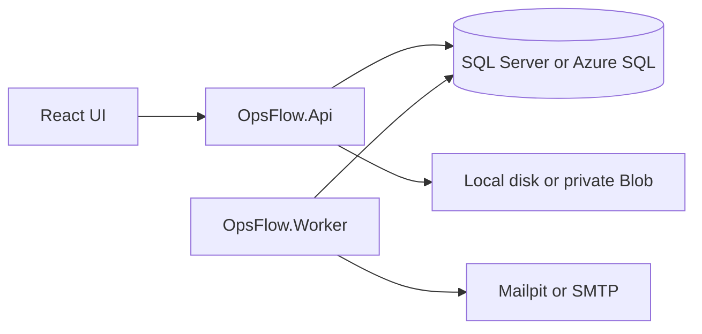

# Architecture

OpsFlow is a modular monolith plus one worker process.

- `OpsFlow.Domain` holds statuses, SLA math, permissions, and attachment rules.
- `OpsFlow.Application` holds contracts and validation. It does not reference EF.
- `OpsFlow.Infrastructure` holds EF Core, Identity, services, the outbox, and storage. Services use `OpsFlowDbContext` directly. There is no generic repository.
- `OpsFlow.Api` is the HTTP host and, in production, the built React files.
- `OpsFlow.Worker` polls the database. It is not a Windows Service.

## Decisions

Application services live beside the DbContext instead of behind repositories. A repository would only forward EF calls. Transactions, conditional updates, and the reporting procedure are clearer next to the model.

Identity cookies authenticate the browser. Organization role is a membership row, not an ASP.NET role, because one person can be an admin in one organization and a technician in another.

Notifications use an outbox in the same transaction as the business change. The worker delivers mail afterwards. That avoids sending email inside an EF retry delegate.

Migrations are an explicit command or a manual Container Apps job. The API does not migrate on startup, so a bad migration cannot take down every replica automatically.

## Delete behavior

The API does not delete work orders, comments, activity, or audit rows. Cancel is the terminal business action. Attachments can be deleted. Foreign keys restrict organization deletion while work, memberships, or audit rows exist. Comments, activity, attachments, and SLA escalations cascade if a work order row is removed by an operator in SQL. Audit rows do not cascade. Membership removal is blocked while the person is a requester or current assignee.
