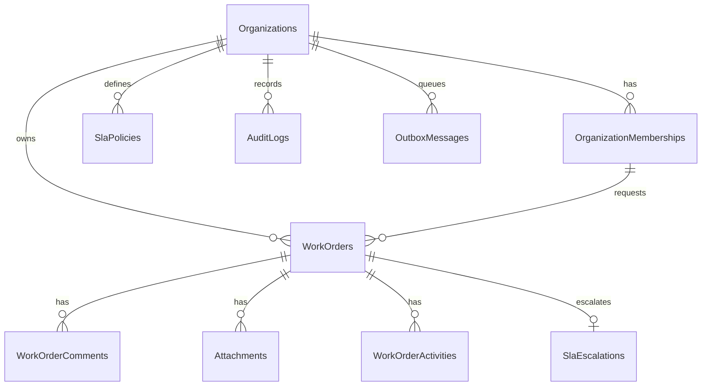

# Database



EF Core migrations in `src/OpsFlow.Infrastructure/Persistence/Migrations` create the schema, including `dbo.usp_OrganizationWorkOrderReport`. `Down` drops that procedure before the tables. The procedure body is the `ReportingSql` constant, so a future change needs a new migration rather than an edit that would surprise already-applied environments. The SQL uses features available on Azure SQL Database and SQL Server 2022.

The report cohort is work orders for one organization with `CreatedAtUtc >= @FromUtc` and `CreatedAtUtc < @ToUtc`. `CohortCount` is the denominator for the status and priority breakdowns. `OverdueCount` is the subset still `Open`, `Assigned`, or `InProgress` with `DueAtUtc` before `SYSUTCDATETIME()`. On-hold work is excluded because the SLA clock is paused. Resolution min, max, and average use wall-clock seconds from creation to `ResolvedAtUtc`. The average's denominator is the resolved count, not the cohort count.

Useful indexes include the unique `(OrganizationId, Number)` key and `IX_WorkOrders_Org_Status_Created_Number` on `(OrganizationId, Status, CreatedAtUtc, Number)` with included list columns. Child rows reference `(WorkOrderId, OrganizationId)`, so a comment cannot point at another organization's work order. The requester must be a member of the same organization. An assignee, when set, must be a member of that organization. SQL Server skips a composite foreign key when the assignee is null.

`WorkOrders.RowVersion` is a SQL Server `rowversion`.

Apply with:

```bash
dotnet run --project src/OpsFlow.Api -- --migrate
```

In Azure, start the manual Container Apps job `${prefix}-migrate` after `infra/bicep/grant-sql-users.sql`. The migrator identity is `db_ddladmin`. The API and worker identities are `db_datareader` and `db_datawriter` plus `EXECUTE` on the report procedure for the API. Do not give the running API schema rights.

To roll back an application release, deploy the previous container image. Roll back a migration only with a reviewed `dotnet ef database update <previous>` against the target database. Practice that on a copy first. The initial migration's `Down` drops the schema.

Benchmark results: **not measured**. See the README for the command. Do not point it at the development or production database.
